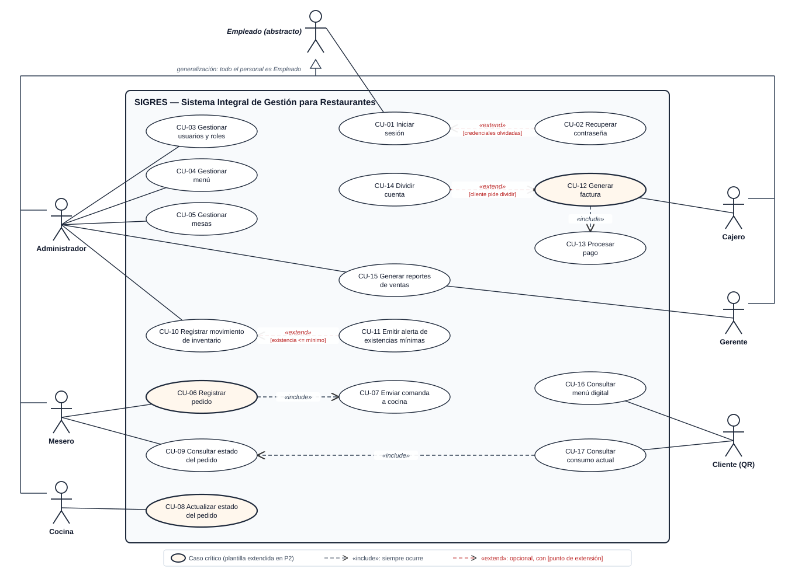

# G1-P1 · Diagrama integral de casos de uso de SIGRES

- Fuente editable: [diagrama_casos_uso.drawio](./diagrama_casos_uso.drawio) (se abre en diagrams.net)
- Imagen: [diagrama_casos_uso.svg](./diagrama_casos_uso.svg)

## 1. Qué cambié respecto al SRS del equipo

El SRS trae **8 diagramas separados por módulo** (figuras 1 a 8), cada uno con su propia frontera. Al revisarlos encontré casos repetidos («Ver disponibilidad de mesas» aparece en los módulos 2 y 6; «Consultar estado del pedido» en los módulos 2 y 8), un actor que aparece en los diagramas pero no en la lista de roles (Cocina) y CRUD separado como caso. Este diagrama los **integra en una sola frontera del sistema**, sin duplicados, con una generalización de actores y relaciones justificadas.

## 2. Actores (todos fuera de la frontera)

| Actor | Tipo | Objetivo frente al sistema |
|---|---|---|
| **Empleado** | Abstracto (generalización) | Reúne lo común a todo el personal: autenticarse. No lo usa nadie directamente. |
| **Mesero** | Primario | Tomar el pedido en la mesa y saber cuándo está listo. |
| **Cocina** | Primario | Recibir comandas en orden de llegada e informar su avance. |
| **Cajero** | Primario | Facturar el consumo de una mesa, cobrar y liberarla. |
| **Administrador** | Primario | Configurar el restaurante (personal, menú, mesas, inventario). |
| **Gerente** | Primario | Consultar ventas para tomar decisiones (solo lectura). |
| **Cliente** | Primario (sin cuenta) | Ver el menú y su consumo desde el QR de la mesa, sin poder pedir. |

**Generalización:** Mesero, Cocina, Cajero, Administrador y Gerente **son** Empleados. Así heredan la asociación con *Iniciar sesión* y no se dibujan cinco líneas al mismo caso. El Cliente **no** es Empleado: usa el QR sin autenticarse (RNF-09, IU-12).

## 3. Catálogo de casos de uso (17 casos, verbo + objeto)

| CU | Nombre | Iniciador | RF que atiende |
|---|---|---|---|
| CU-01 | Iniciar sesión | Empleado (heredado por los 5 roles) | RF02 |
| CU-02 | Recuperar contraseña | Extiende CU-01 | RF02 |
| CU-03 | Gestionar usuarios y roles | Administrador | RF01, RF03 |
| CU-04 | Gestionar menú | Administrador | RF08, RF09 |
| CU-05 | Gestionar mesas | Administrador | RF14 |
| CU-06 | Registrar pedido | Mesero | RF04, RF14 (estado de mesa) |
| CU-07 | Enviar comanda a cocina | Incluido por CU-06 | RF05 |
| CU-08 | Actualizar estado del pedido | Cocina | RF07 |
| CU-09 | Consultar estado del pedido | Mesero; incluido por CU-17 | RF06 |
| CU-10 | Registrar movimiento de inventario | Administrador | RF10 |
| CU-11 | Emitir alerta de existencias mínimas | Extiende CU-10 | RF11 |
| CU-12 | Generar factura | Cajero | RF12 |
| CU-13 | Procesar pago | Incluido por CU-12 | RF13 |
| CU-14 | Dividir cuenta | Extiende CU-12 | RF13 (pago por partes, FA-1 del CU-07 del SRS) |
| CU-15 | Generar reportes de ventas | Gerente, Administrador | RF15 |
| CU-16 | Consultar menú digital | Cliente | RF16 |
| CU-17 | Consultar consumo actual | Cliente | RF17, RF06 |

> Los 17 casos son distintos y todos tienen iniciador: un actor asociado, o un caso base que los incluye o los extiende (regla 6 de la sección 7 de la rúbrica).

**Criterio CRUD (regla 1 de la sección 7):** «Gestionar usuarios y roles», «Gestionar menú» y «Gestionar mesas» agrupan crear, consultar, editar y desactivar porque comparten actor, reglas y flujo. Registro y roles (RF01 y RF03) se unen porque los hace el mismo actor sobre el mismo objeto (la cuenta del empleado). *Registrar movimiento de inventario* **no** se agrupa dentro de un «gestionar inventario» porque tiene una regla propia (no se permiten existencias negativas) y dispara la alerta CU-11.

## 4. Justificación de cada relación

| Relación | Dirección | Justificación (una línea) |
|---|---|---|
| **«include»** CU-06 → CU-07 | Del base al incluido | Todo pedido confirmado **siempre** se envía a cocina: no existe pedido registrado que no llegue a la comanda (RF04 «envío automático»). |
| **«include»** CU-12 → CU-13 | Del base al incluido | Generar la factura **siempre** termina en registrar su pago: la mesa solo se libera con pago confirmado (RN-06 del CU-07 del SRS). |
| **«include»** CU-17 → CU-09 | Del base al incluido | Consultar el consumo **siempre** muestra el estado de cada pedido (RF17). Se reutiliza CU-09 en vez de duplicarlo para el cliente. |
| **«extend»** CU-02 → CU-01 | Del que extiende al base | Punto de extensión **[credenciales olvidadas]**: solo ocurre si el empleado no recuerda su contraseña. |
| **«extend»** CU-11 → CU-10 | Del que extiende al base | Punto de extensión **[existencia ≤ mínimo]**: la alerta solo se emite si el movimiento deja el insumo en o por debajo del mínimo (RF11). |
| **«extend»** CU-14 → CU-12 | Del que extiende al base | Punto de extensión **[el cliente pide dividir la cuenta]**: es opcional; la mayoría de mesas paga en una sola cuenta. |
| **Generalización** Mesero, Cocina, Cajero, Administrador, Gerente → Empleado | Del hijo al padre | Comparten la autenticación y el control por rol (RNF-01, RNF-02); el Cliente queda fuera porque no se autentica. |

**¿Por qué «Enviar comanda» es include y no extend?** Porque no tiene condición: si el pedido se confirma, se envía. Si dependiera de algo («solo si el pedido tiene platos calientes»), sería extend.

**¿Por qué «Dividir cuenta» es extend y no include?** Porque la factura se puede cobrar completa sin dividir. Es un comportamiento opcional que se activa en un punto concreto.
