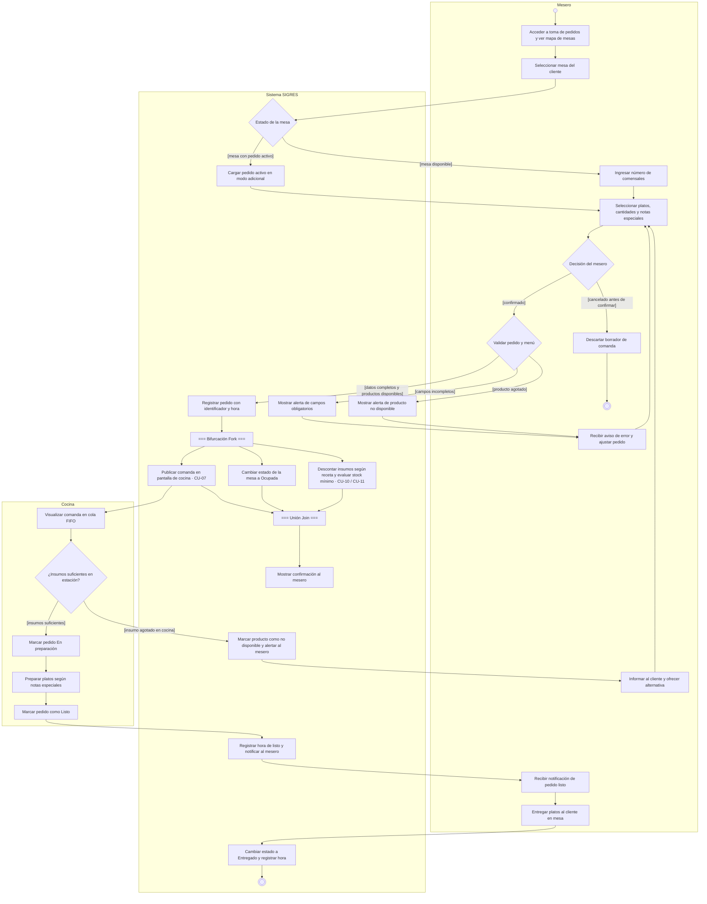
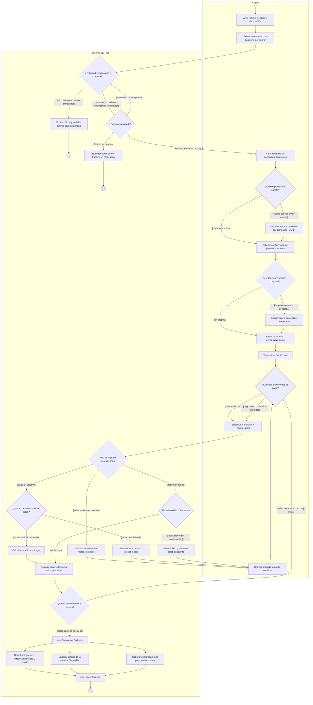

# G1-P2 · Diagramas de actividades (casos de uso críticos)

**Caso de estudio:** SIGRES — Sistema Integral de Gestión para Restaurantes  
**Casos modelados:** flujo crítico operativo mesa → cocina → caja (**CU-06**, **CU-07**, **CU-08**, **CU-12**, **CU-13** y **CU-14**).  
**Convención:** cada calle (*swimlane*) separa responsabilidades por actor; toda decisión lleva guardas entre corchetes `[condición]` cubriendo todas sus salidas; las ramas paralelas usan bifurcación (*Fork*) y unión (*Join*).

---

## 1. Diagrama de actividades 1 · Registrar pedido y ciclo en cocina (CU-06, CU-07 y CU-08)

Modela el recorrido completo desde que el mesero abre una comanda en mesa hasta que cocina prepara los platos y el mesero confirma la entrega al cliente. Incluye el manejo de mesa ocupada (adicionales), cancelación antes de confirmar, faltantes de inventario en cocina y ejecución paralela tras confirmar el pedido.

### Notas de diseño del Diagrama 1
- **Concurrencia explícita (Fork → Join):** al confirmarse el pedido, el sistema ejecuta de manera concurrente el despacho de la comanda a cocina (`CU-07`), el bloqueo visual de la mesa como `Ocupada` y el descuento de insumos por receta (`CU-10` con posible disparo de alerta `CU-11`).
- **Trazabilidad exacta con plantillas:** cada salida con guarda corresponde a un paso, flujo alterno o excepción de `CU-06` y `CU-08` en [02_plantillas_extendidas.md](./02_plantillas_extendidas.md).

---

## 2. Diagrama de actividades 2 · Facturar pedido y procesar pago (CU-12, CU-13 y CU-14)

Modela el cierre financiero de una mesa desde que el cajero consulta las cuentas activas hasta el pago completo (único o mixto, en efectivo o electrónico, con o sin división de cuenta y propina voluntaria) y la liberación de la mesa.

### Notas de diseño del Diagrama 2
- **Concurrencia explícita (Fork → Join):** una vez verificado que el saldo pendiente llegó a cero, el sistema consolida simultáneamente el registro financiero, la liberación de la mesa y la emisión del comprobante.
- **Separación legal y contable:** incluye de forma explícita la decisión de propina voluntaria (Ley 1935 de 2018) y el ciclo iterativo `[saldo restante > 0 en pago mixto]` para soportar pagos con dos o más métodos sin duplicar la factura.

---

## 3. Trazabilidad de ramas entre diagramas y plantillas

| Diagrama | Rama / guarda en el diagrama | Flujo en [02_plantillas_extendidas.md](./02_plantillas_extendidas.md) |
|---|---|---|
| Diagrama 1 | `[mesa con pedido activo]` | CU-06 · Flujo alterno `2a` (agregar ítems adicionales) |
| Diagrama 1 | `[cancelado antes de confirmar]` | CU-06 · Flujo alterno `5a` (cancelar productos antes de confirmar) |
| Diagrama 1 | `[campos incompletos]` | CU-06 · Excepción `4b` |
| Diagrama 1 | `[producto agotado]` | CU-06 · Excepción `4c` |
| Diagrama 1 | `[insumo agotado en cocina]` | CU-08 · Flujo alterno `2a` |
| Diagrama 2 | `[sin pedidos activos o entregados]` | CU-12 · Excepción `2b` |
| Diagrama 2 | `[factura ya pagada]` | CU-12 · Excepción `7b` |
| Diagrama 2 | `[cliente solicita dividir cuenta]` | CU-12 · Flujo alterno `3a` (extiende a CU-14) |
| Diagrama 2 | `[propina voluntaria aceptada]` / `[sin propina]` | CU-12 · Paso 3 y flujo alterno `4a` |
| Diagrama 2 | `[pago mixto con varios métodos]` / `[saldo restante > 0]` | CU-12 · Flujo alterno `5a` |
| Diagrama 2 | `[monto insuficiente]` | CU-12 · Excepción `5b` |
| Diagrama 2 | `[método no seleccionado]` / `[rechazado o sin confirmación]` | CU-12 · Excepción `5c` |
