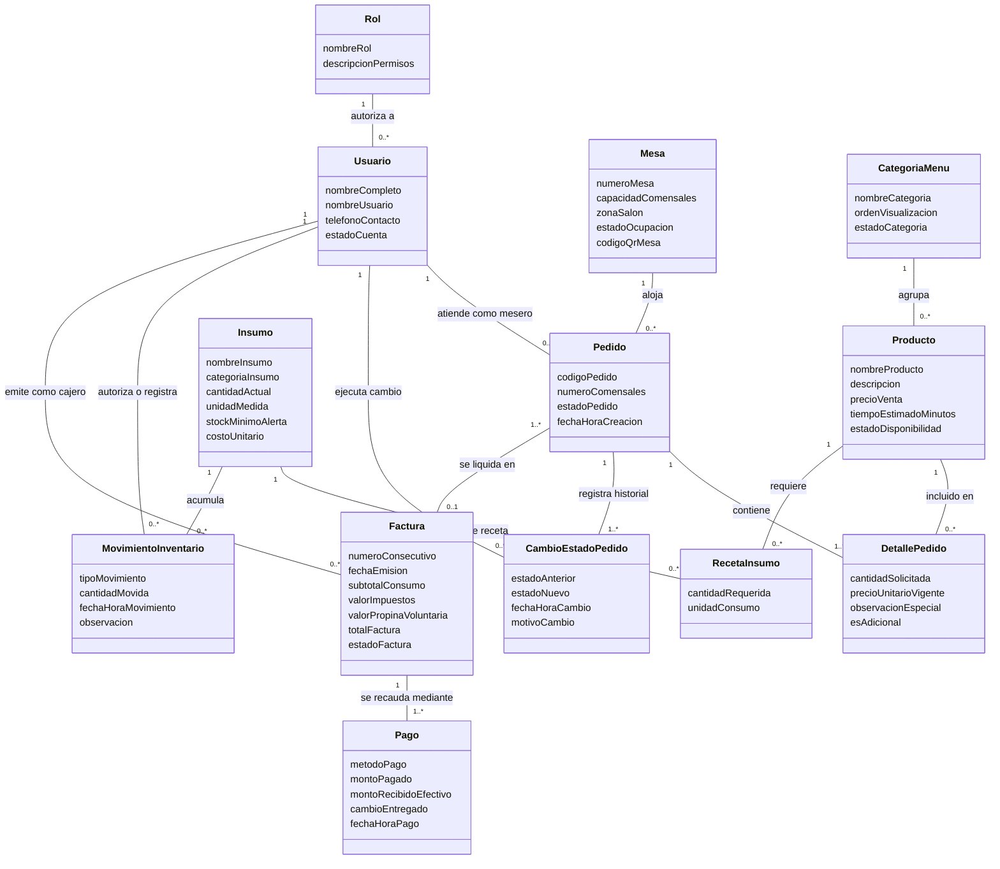

# G1-P2 · Modelo de dominio conceptual (SIGRES)

**Caso de estudio:** SIGRES — Sistema Integral de Gestión para Restaurantes  
**Alcance:** abstracción de los conceptos del negocio y sus relaciones (13 clases conceptuales). Conforme a la regla de arbitraje §7.5 de `Rubricas_G1.md`, este modelo **no incluye métodos, tipos técnicos de almacenamiento ni llaves técnicas de enlace**.

---

## 1. Diagrama del modelo de dominio

---

## 2. Catálogo de clases conceptuales y coherencia con el negocio

| # | Clase conceptual | Significado en el restaurante | Clases con ≥2 atributos de negocio | Relación con las plantillas |
|---|---|---|---|---|
| 1 | **Rol** | Perfil operativo que delimita responsabilidades (`Administrador`, `Mesero`, `Cocina`, `Cajero`, `Gerente`). | `nombreRol`, `descripcionPermisos` | Precondición de acceso en CU-06, CU-08 y CU-12. |
| 2 | **Usuario** | Empleado del restaurante que opera el sistema según su rol (mesero, cocinero, cajero, etc.). | `nombreCompleto`, `nombreUsuario`, `telefonoContacto`, `estadoCuenta` | Actores internos de todas las plantillas. |
| 3 | **Mesa** | Espacio físico del comedor con capacidad, ubicación, estado (`Disponible`/`Ocupada`) y QR propio. | `numeroMesa`, `capacidadComensales`, `zonaSalon`, `estadoOcupacion`, `codigoQrMesa` | CU-06 (pasos 1 y 7) y CU-12 (pasos 1 y 8). |
| 4 | **CategoriaMenu** | Agrupación lógica de la carta (`Entradas`, `Platos fuertes`, `Bebidas`, `Postres`). | `nombreCategoria`, `ordenVisualizacion`, `estadoCategoria` | CU-06 (paso 3). |
| 5 | **Producto** | Plato o bebida ofertado al cliente con su precio vigente y disponibilidad en tiempo real. | `nombreProducto`, `descripcion`, `precioVenta`, `tiempoEstimadoMinutos`, `estadoDisponibilidad` | CU-06 (paso 4 y excepción `4c`) y CU-08 (flujo alterno `2a`). |
| 6 | **Pedido** | Comanda levantada en una mesa con su número de comensales y estado unificado del servicio. | `codigoPedido`, `numeroComensales`, `estadoPedido`, `fechaHoraCreacion` | Protagonista de CU-06 y CU-08. |
| 7 | **DetallePedido** *(clase de asociación)* | Renglón de consumo que vincula un `Pedido` con un `Producto`, conservando cantidad, precio histórico y notas de preparación. | `cantidadSolicitada`, `precioUnitarioVigente`, `observacionEspecial`, `esAdicional` | CU-06 (paso 4 y flujo alterno `2a`) y CU-08 (paso 1). |
| 8 | **CambioEstadoPedido** | Traza cronológica de cada transición del pedido (`Pendiente` → `En preparación` → `Listo` → `Entregado` o `Cancelado`). | `estadoAnterior`, `estadoNuevo`, `fechaHoraCambio`, `motivoCambio` | CU-08 (pasos 3, 5, 7 y flujo alterno `4a`). |
| 9 | **Insumo** | Materia prima o ingrediente controlado en bodega y cocina con su umbral de alerta mínima. | `nombreInsumo`, `categoriaInsumo`, `cantidadActual`, `unidadMedida`, `stockMinimoAlerta`, `costoUnitario` | CU-06 (paso 7) y CU-08 (flujo alterno `2a`). |
| 10 | **RecetaInsumo** *(clase de asociación)* | Ficha de consumo que define cuánto de cada `Insumo` gasta una unidad de `Producto`. Corrige el vacío H4 del SRS. | `cantidadRequerida`, `unidadConsumo` | CU-06 (paso 7 y regla de negocio RN-03). |
| 11 | **MovimientoInventario** | Entrada por reabastecimiento o salida automática por pedido confirmado que justifica las variaciones de existencias. | `tipoMovimiento`, `cantidadMovida`, `fechaHoraMovimiento`, `observacion` | CU-06 (paso 7) y CU-10/CU-11. |
| 12 | **Factura** | Documento consecutivo que liquida uno o varios pedidos entregados, discriminando subtotal, impuestos y propina voluntaria. | `numeroConsecutivo`, `fechaEmision`, `subtotalConsumo`, `valorImpuestos`, `valorPropinaVoluntaria`, `totalFactura`, `estadoFactura` | Protagonista de CU-12 (pasos 2 a 8). |
| 13 | **Pago** | Transacción individual de recaudo contra una factura; permite pagos mixtos con múltiples métodos y cálculo de cambio. | `metodoPago`, `montoPagado`, `montoRecibidoEfectivo`, `cambioEntregado`, `fechaHoraPago` | CU-12 (pasos 5, 6 y flujo alterno `5a`). |

---

## 3. Justificación de decisiones de modelado

1. **Clases de asociación (`DetallePedido` y `RecetaInsumo`):** ambas nacen de relaciones conceptuales muchos a muchos que poseen atributos propios del vínculo:
   - Un pedido incluye varios productos y un producto figura en muchos pedidos; el precio congelado al momento de pedir (`precioUnitarioVigente`) y la nota de cocina (`observacionEspecial`) no pertenecen ni al `Pedido` ni al `Producto` por separado, sino a `DetallePedido`.
   - Un plato usa varios insumos y un insumo interviene en varios platos; la porción exacta (`cantidadRequerida`) pertenece a `RecetaInsumo`. Sin esta clase, el descuento automático exigido en RF10 no tendría fundamento conceptual (hallazgo H4).
2. **Separación entre `Pedido` y `Factura` (cardinalidad `1..*` a `0..1`):** una mesa puede generar un pedido inicial y luego pedidos adicionales (o estar aún en consumo sin facturar `0`), y al cierre toda la cuenta de esa mesa se consolida en una `Factura`.
3. **Separación entre `Factura` y `Pago` (cardinalidad `1` a `1..*`):** resuelve la contradicción H7 del SRS al permitir tanto un único pago completo como pagos mixtos o parciales al dividir la cuenta (`CU-14`).
4. **Coherencia estricta con las plantillas:** ningún concepto mencionado en `CU-06`, `CU-08` o `CU-12` (mesa, comensal, categoría, producto, observación, estado, cambio, insumo, receta, factura, propina, método de pago, cambio en efectivo) queda huérfano fuera del dominio.
