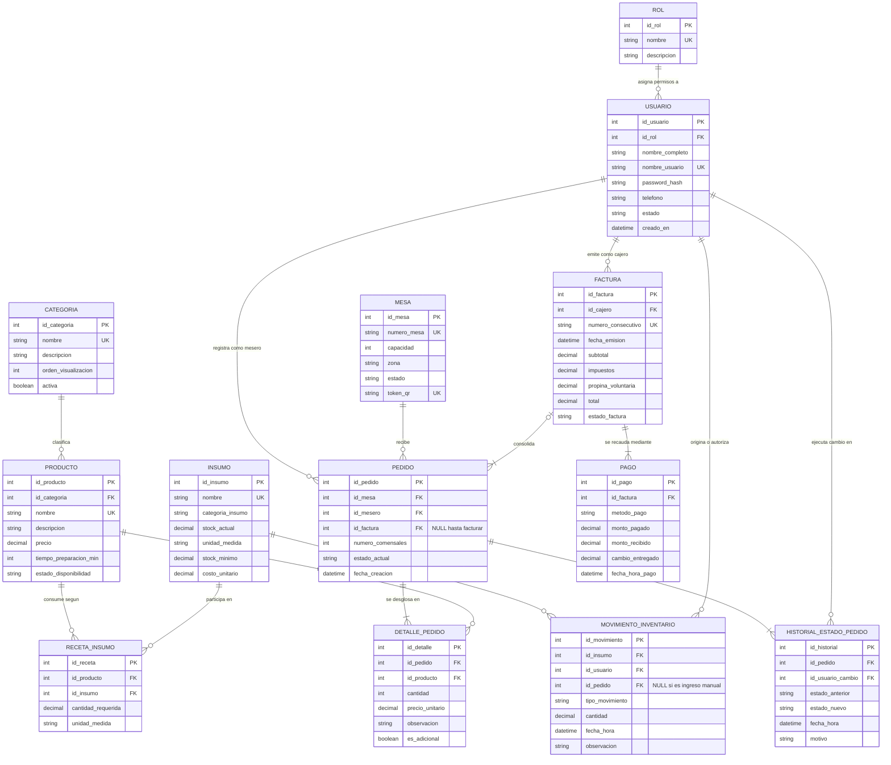

# G1-P2 · Modelo Entidad-Relación (MER)

**Caso de estudio:** SIGRES — Sistema Integral de Gestión para Restaurantes  
**Notación declarada:** **Pata de Gallo (Crow's Foot)** — Ingeniería de la Información.  

### Leyenda de notación (cardinalidad y participación)
- `||` : exactamente uno — **participación total (obligatoria)**, mínimo 1, máximo 1.
- `|o` / `o|` : cero o uno — **participación parcial (opcional)**, mínimo 0, máximo 1.
- `|{` / `}|` : uno o muchos — **participación total (obligatoria)**, mínimo 1, máximo N.
- `o{` / `}o` : cero o muchos — **participación parcial (opcional)**, mínimo 0, máximo N.

---

## 1. Diagrama Entidad-Relación (Pata de Gallo)

---

## 2. Relaciones, cardinalidad, participación y justificación

| Relación | Entidad A (participación) | Entidad B (participación) | Cardinalidad | Clasificación y justificación |
|---|---|---|---|---|
| `ROL — USUARIO` | `ROL` (**parcial**, un rol recién creado puede no tener usuarios aún) | `USUARIO` (**total**, todo usuario tiene un rol activo; RN-03) | `1 : N` | Control de acceso RBAC (5 roles: Administrador, Mesero, Cocina, Cajero, Gerente). |
| `USUARIO — PEDIDO` | `USUARIO` (**parcial**, un cajero o gerente no toma pedidos) | `PEDIDO` (**total**, todo pedido tiene mesero responsable) | `1 : N` | Trazabilidad de quién tomó la orden. |
| `MESA — PEDIDO` | `MESA` (**parcial**, una mesa nueva o libre puede tener 0 pedidos) | `PEDIDO` (**total**, todo pedido pertenece a una mesa) | `1 : N` | Control de ocupación y consumo por mesa. |
| `CATEGORIA — PRODUCTO` | `CATEGORIA` (**parcial**, una categoría nueva puede no tener platos) | `PRODUCTO` (**total**, todo producto se ubica en una categoría) | `1 : N` | Organización del menú digital y de la app del mesero. |
| `PEDIDO — PRODUCTO` → **`DETALLE_PEDIDO`** | `PEDIDO` (**total**: mínimo 1 ítem; RN-02 de CU-04) | `PRODUCTO` (**parcial**: un plato nuevo puede no haberse pedido) | `N : M` resuelta | **Entidad asociativa con atributos propios:** `cantidad`, `precio_unitario` (congelado al pedir), `observacion` y `es_adicional`. |
| `PRODUCTO — INSUMO` → **`RECETA_INSUMO`** | `PRODUCTO` (**parcial**: bebidas empacadas pueden no desglosarse) | `INSUMO` (**parcial**: insumos recién creados sin asignar a plato) | `N : M` resuelta | **Entidad asociativa con atributos propios:** `cantidad_requerida` y `unidad_medida`. Resuelve el hallazgo H4 (hace posible el descuento automático de RF10). |
| `PEDIDO — HISTORIAL_ESTADO_PEDIDO` | `PEDIDO` (**total**: nace con registro `Pendiente`) | `HISTORIAL_ESTADO_PEDIDO` (**total**: no existe traza sin pedido) | `1 : N` | **Entidad débil por existencia:** conserva los tiempos entre `Pendiente`, `En preparación`, `Listo`, `Entregado` o `Cancelado` para RF07 y métricas. |
| `INSUMO — MOVIMIENTO_INVENTARIO` | `INSUMO` (**parcial**) | `MOVIMIENTO_INVENTARIO` (**total**) | `1 : N` | Bitácora de entradas por compra y salidas automáticas por pedido. |
| `FACTURA — PEDIDO` | `FACTURA` (**total**: toda factura liquida ≥1 pedido) | `PEDIDO` (**parcial**: un pedido en curso tiene `id_factura` nulo hasta cobrarse) | `1 : N` | Agrupa pedido inicial y adicionales de la mesa en una sola cuenta. |
| `FACTURA — PAGO` | `FACTURA` (**total**: en este flujo toda factura emitida se cobra con ≥1 pago) | `PAGO` (**total**: no existe pago sin factura que lo respalde) | `1 : N` | **Entidad débil por existencia:** soporta pagos únicos, pagos mixtos con varios métodos y liquidación de cuentas divididas (resuelve H7). |

---

## 3. Verificación contra los requisitos de datos del SRS
- **Seguridad e integridad (RNF-01, RNF-04, RNF-06):** `USUARIO` guarda `password_hash` (nunca texto plano) y no existe ninguna entidad que almacene datos personales sensibles de clientes comensales.
- **Trazabilidad financiera (RF12, RF13):** `FACTURA` garantiza `numero_consecutivo` único (`UK`), discrimina `propina_voluntaria` y delega el recaudo a `PAGO`.
- **Soporte a tiempo real y alertas (RF07, RF10, RF11):** `HISTORIAL_ESTADO_PEDIDO` registra cada timestamp de preparación y `INSUMO.stock_minimo` junto con `RECETA_INSUMO` soportan la alerta de existencias bajas.
