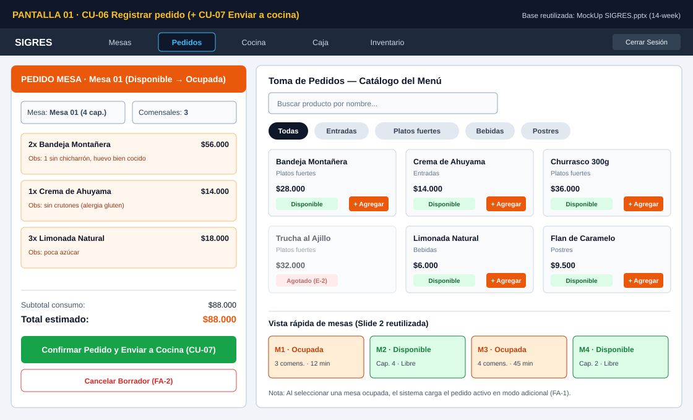
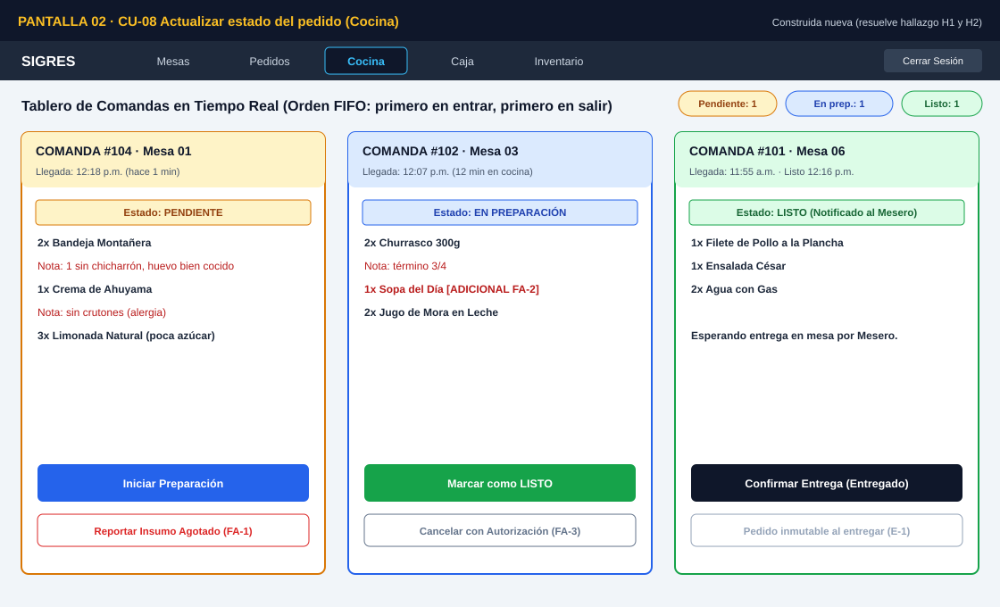
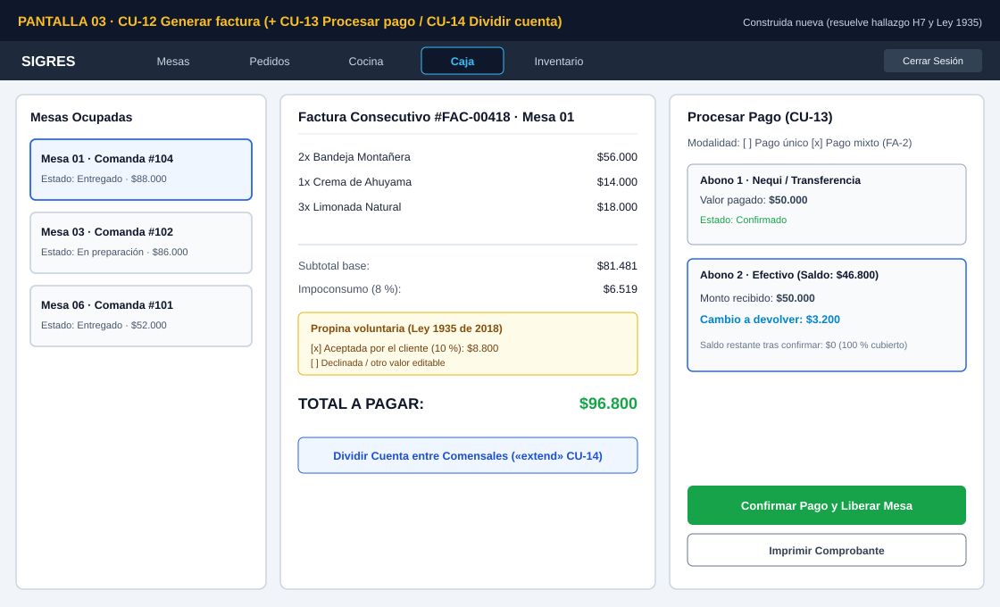

# G1-P2 · Prototipo inicial (mockups de los casos de uso críticos)

**Caso de estudio:** SIGRES — Sistema Integral de Gestión para Restaurantes  
**Insumo reutilizado:** [MockUp SIGRES.pptx](../../../../../../03-execute/14-week/02-optional-activity/MockUp%20SIGRES.pptx) (semana 14 de `03-execute`).  
**Ajuste individual:** la presentación original contenía únicamente dos pantallas sin rótulo de caso de uso (toma de pedidos y mapa de mesas). Para cumplir la rúbrica (criterio C5) se unificó y rotuló la Pantalla 01 y se construyeron desde cero las pantallas críticas faltantes de **Cocina (CU-08)** y **Caja/Facturación (CU-12 / CU-13 / CU-14)** (hallazgo H8).

---

## 1. Índice de pantallas (cero pantallas huérfanas)

| # | Archivo del prototipo | Caso(s) de uso que atiende | Origen |
|---|---|---|---|
| **Pantalla 01** | [pantalla_01_CU06_registrar_pedido.svg](./prototipo/pantalla_01_CU06_registrar_pedido.svg) | **CU-06 · Registrar pedido** (+ disparo de **CU-07**) | Reutilizada de las diapositivas 1 y 2 de `MockUp SIGRES.pptx` + ajustes (observaciones por plato, estado agotado, cambio a modo adicional). |
| **Pantalla 02** | [pantalla_02_CU08_panel_cocina.svg](./prototipo/pantalla_02_CU08_panel_cocina.svg) | **CU-08 · Actualizar estado del pedido (Cocina)** | Construida nueva (sub-pantalla omitida en el prototipo de la semana 14; resuelve H1, H2 y H8). |
| **Pantalla 03** | [pantalla_03_CU12_facturacion_caja.svg](./prototipo/pantalla_03_CU12_facturacion_caja.svg) | **CU-12 · Generar factura** (+ **CU-13 · Procesar pago** y **CU-14 · Dividir cuenta**) | Construida nueva (sub-pantalla omitida en el prototipo de la semana 14; resuelve H7, Ley 1935 y H8). |

---

## 2. Vistas rotuladas

### Pantalla 01 · CU-06 Registrar pedido (+ CU-07 Enviar comanda a cocina)

- **Qué se conservó de `MockUp SIGRES.pptx`:** barra superior `SIGRES` (`Mesas`, `Pedidos`, `Inventario`, `Cerrar Sesión`), panel izquierdo del carrito por mesa con total acumulado, buscador y grilla de platos por categoría junto con la vista rápida de ocupación y tiempo de mesas.
- **Qué se ajustó:** rótulo explícito del caso de uso en cabecera, selector de número de comensales, campo de observaciones especiales por plato (alergias o cocción), indicador de producto agotado y flujo de pedido adicional sobre mesa ocupada (FA-1).

---

### Pantalla 02 · CU-08 Actualizar estado del pedido (Panel de cocina)

- **Elementos clave:** tablero en orden FIFO (primero en entrar, primero en salir), contadores por estado unificado (`Pendiente`, `En preparación`, `Listo`), resaltado en rojo para notas especiales de cocina e ítems adicionales (`FA-2`), acción de reporte de insumo agotado (`FA-1`) y bloqueo cuando el pedido pasa a `Entregado` (`E-1`).

---

### Pantalla 03 · CU-12 Generar factura (+ CU-13 Procesar pago / CU-14 Dividir cuenta)

- **Elementos clave:** selección de mesas ocupadas con consumo entregado, desglose de subtotal e impuestos, casilla explícita de aceptación o declinación de **propina voluntaria (Ley 1935 de 2018)**, botón de división de cuenta (`CU-14`), soporte para pago único o pago mixto con múltiples métodos (`FA-2`), cálculo automático de cambio en efectivo y liberación de la mesa únicamente al cubrir el 100 % del saldo.
