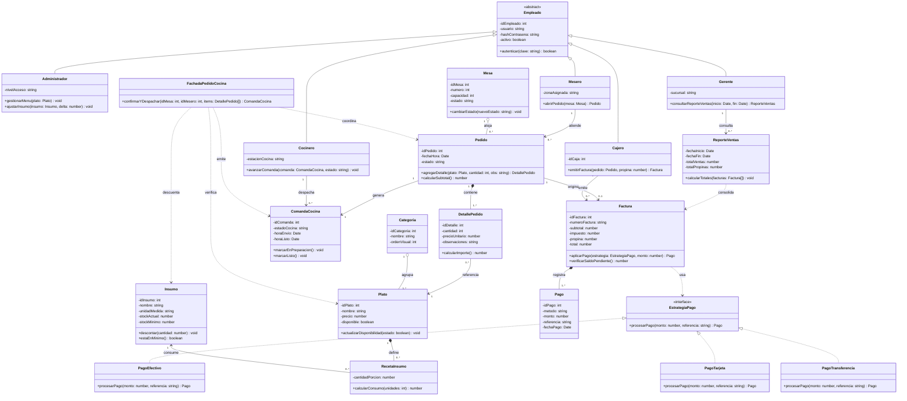

# A2 y A3 · Diagrama de clases UML y patrones de diseño

**Proyecto:** SIGRES  
**Imagen vectorial exportada:** [diagrama_clases.svg](./diagrama_clases.svg)  
**Fuente editable Mermaid:** incluida abajo en sincronía 1:1 con `diagrama_clases.svg`

---

## 1. Diagrama de clases (A2)

### Relación con los requisitos y separación de responsabilidades
* **Composición:** `Pedido *-- DetallePedido`, `Factura *-- Pago` y `Plato *-- RecetaInsumo` (los ítems, pagos y líneas de receta dependen del ciclo de vida de su contenedor).
* **Agregación:** `Mesa o-- Pedido` y `Categoria o-- Plato` (los pedidos históricos o platos permanecen si se reorganiza una mesa o categoría).
* **Herencia y Polimorfismo:** `Empleado` generaliza a `Administrador`, `Mesero`, `Cocinero` y `Cajero`. La interfaz `EstrategiaPago` tiene 3 implementaciones polimórficas (`PagoEfectivo`, `PagoTarjeta`, `PagoTransferencia`), por lo que `Factura.aplicarPago()` procesa pagos simples o mixtos sin conocer la lógica de cada medio.
* **Cohesión (Regla 5):** Ninguna clase mezcla interfaz gráfica, persistencia SQL ni reportes; las clases de dominio mantienen únicamente estado y reglas propias del negocio.

---

## 2. Catálogo de patrones de diseño aplicados (A3)

| Patrón GoF | Problema concreto del caso (SIGRES) | Por qué ese patrón | Clases que lo implementan | Qué mejora en mantenibilidad |
|---|---|---|---|---|
| **Estrategia (Strategy)** | `RF13` exige soportar pagos en efectivo, tarjeta, transferencia y pagos mixtos o divididos en una misma factura (`H7` del análisis). | Encapsula cada algoritmo de validación y generación de comprobante fuera de `Factura`, evitando condicionales `if/else` rígidos. | `EstrategiaPago` (interfaz), `PagoEfectivo`, `PagoTarjeta`, `PagoTransferencia` y contexto `Factura`. | Agregar un nuevo medio de pago (ej. billetera digital QR) requiere crear una sola clase nueva sin modificar ni probar de nuevo `Factura`. |
| **Fachada (Facade)** | `RF04`, `RF05` y `RF10` exigen que al confirmar un pedido en mesa se cree el pedido, se verifique disponibilidad en catálogo, se descuente inventario por receta y se envíe la comanda a cocina. | Ofrece un punto de entrada único de alto nivel para el controlador, ocultando la orquestación interna entre dominio de pedido, catálogo, inventario y cocina. | `FachadaPedidoCocina` coordinando `Pedido`, `Plato`, `Insumo` y `ComandaCocina`. | Si cambia la regla de verificación de inventario o el canal de despacho KDS, la capa de presentación no sufre cambios. |
