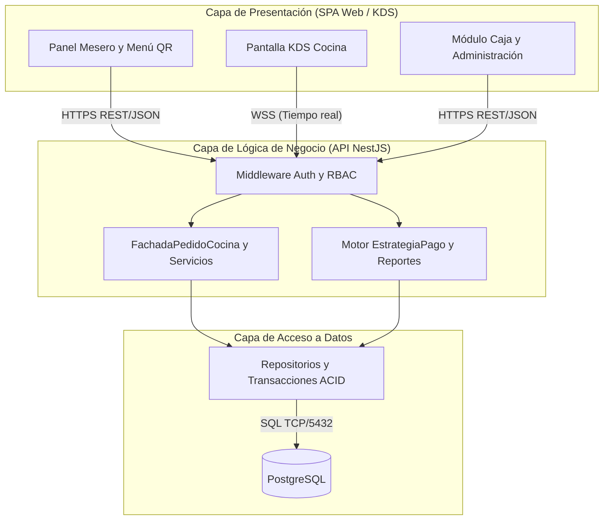

# A4 · Arquitectura del software y tabla de decisiones

**Proyecto:** SIGRES  
**Imagen vectorial exportada:** [diagrama_arquitectura.svg](./diagrama_arquitectura.svg)

---

## 1. Estilo arquitectónico y comunicación entre capas

* **Estilo seleccionado:** **Arquitectura en 3 capas estrictas** (Presentación $\to$ Lógica de Negocio $\to$ Acceso a Datos).
* **Regla de dependencias:** Ninguna capa superior salta a la inferior; la capa de presentación consume exclusivamente contratos de la capa de lógica de negocio mediante **HTTP/REST con JSON** y **WebSockets (WSS)** para eventos en tiempo real hacia cocina (KDS). La capa de lógica de negocio delega la persistencia a repositorios en la capa de datos.

---

## 2. Tabla de decisiones frente a requisitos no funcionales (RNF)

| RNF / Aspecto | Decisión de diseño | Alternativa descartada | Razón del descarte |
|---|---|---|---|
| **Estilo arquitectónico** (3 capas estrictas) | Separar Presentación, Lógica de Negocio y Datos con repositorios desacoplados. | Monolito acoplado donde la vista ejecuta consultas SQL directas. | Mezcla responsabilidades, impide probar reglas de negocio aisladas y rompe la seguridad de acceso (`RNF-02`). |
| **`RNF-02`** (Acceso por rol) | Middleware centralizado de autenticación (JWT) y autorización por rol (`RBAC`) entre la capa de presentación y todos los servicios de negocio. | Validar permisos únicamente ocultando botones en la interfaz web. | Un usuario malintencionado puede invocar la API REST directamente saltándose la interfaz. |
| **`RNF-17`** (Comanda en cocina $\le 5\text{ s}$) | Canal persistente **WebSocket** desde el servicio de cocina hacia la pantalla KDS al confirmar un pedido en `FachadaPedidoCocina`. | Polling HTTP desde cocina cada 15–30 segundos. | Aumenta la latencia por encima de los 5 segundos exigidos y genera tráfico innecesario en la red local. |
| **`RNF-07`** (Pedido completo $\le 3\text{ min}$, API $\le 500\text{ ms}$) | Índices en llaves foráneas frecuentes (`pedido.id_mesa`, `plato.id_categoria`) y caché en memoria del menú activo. | Consultar todo el catálogo sin índices en cada recarga de mesa. | Degrada el tiempo de respuesta cuando hay múltiples meseros tomando pedidos simultáneamente. |
| **`RNF-19`** (Integridad transaccional ACID) | Envío de pedido, emisión de comanda, descuento de receta y registro de pagos múltiples dentro de transacciones ACID en PostgreSQL. | Ejecutar operaciones independientes sin transacción (`autocommit`). | Si falla el descuento de un insumo o un pago parcial, el pedido o factura queda inconsistente. |
