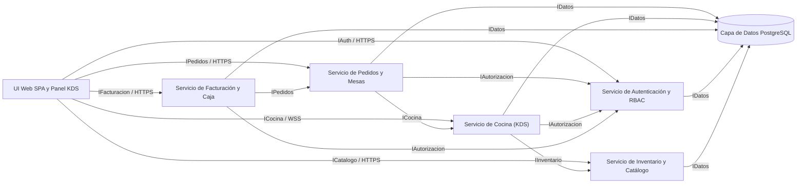

# A5 · Vista de componentes

**Proyecto:** SIGRES  
**Imagen vectorial exportada:** [diagrama_componentes.svg](./diagrama_componentes.svg)

---

## 1. Diagrama de componentes (Mermaid)

---

## 2. Tabla de interfaces y mapeo de componentes

| Componente | Interfaz que provee | Interfaz que requiere | Clases que agrupa | Requisitos que atiende |
|---|---|---|---|---|
| **UI Web SPA y Panel KDS** | `IGUIWeb` | `IAuth`, `IPedidos`, `ICocina`, `IFacturacion`, `ICatalogo` | Vistas de Salón, KDS, Caja y QR | `RF04`, `RF06`, `RF07`, `RF12`, `RF16`, `RF17` |
| **Servicio de Autenticación y RBAC** | `IAutorizacion` | `IDatos` | `Empleado`, `Mesero`, `Cocinero`, `Cajero` | `RF01`, `RF02`, `RF03`, `RNF-02`, `RNF-06` |
| **Servicio de Pedidos y Mesas** | `IPedidos` | `IAutorizacion`, `ICocina`, `IInventario`, `IDatos` | `Mesa`, `Pedido`, `DetallePedido`, `FachadaPedidoCocina` | `RF04`, `RF05`, `RF06`, `RF14`, `RNF-07` |
| **Servicio de Cocina (KDS)** | `ICocina` | `IAutorizacion`, `IInventario`, `IDatos` | `ComandaCocina` y gestor de canal WebSocket | `RF05`, `RF07`, `RNF-17` |
| **Servicio de Facturación y Caja** | `IFacturacion` | `IAutorizacion`, `IPedidos`, `IDatos` | `Factura`, `Pago`, `EstrategiaPago` y sus 3 implementaciones | `RF12`, `RF13`, `RF15`, `RNF-19` |
| **Servicio de Inventario y Catálogo** | `ICatalogo`, `IInventario` | `IAutorizacion`, `IDatos` | `Plato`, `Categoria`, `Insumo`, `RecetaInsumo` | `RF08`, `RF09`, `RF10`, `RF11`, `RF16` |
| **Capa de Datos (PostgreSQL)** | `IDatos` | Ninguna (recurso base) | Repositorios de persistencia y transacciones | `RNF-19` |
