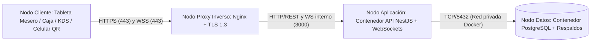

# A6 · Vista de despliegue

**Proyecto:** SIGRES  
**Imagen vectorial exportada:** [diagrama_despliegue.svg](./diagrama_despliegue.svg)

---

## 1. Diagrama de despliegue (Mermaid)

---

## 2. Tabla de nodos, artefactos y protocolos

| Nodo | Artefactos que aloja | Conexión (protocolo y puerto) | Decisión que responde a un RNF |
|---|---|---|---|
| **Nodo Cliente** (Navegador en tableta, PC caja, monitor cocina y móvil QR) | Aplicación Web SPA compilada (React/HTML5/JS) en memoria del navegador | `HTTPS (TCP 443)` para API y `WSS (TCP 443)` para pantalla KDS hacia Proxy | `RNF-06`, `RNF-17`: Todo tráfico externo viaja cifrado con TLS 1.3 y el canal KDS entrega comandas en $\le 5\text{ s}$. |
| **Nodo Proxy Inverso** (Servidor Nginx) | Certificados TLS 1.3, archivos estáticos de la SPA y limitador de tasa (*rate limiting*) | Recibe `443`; reenvía por `HTTP/WS (TCP 3000)` en red interna privada hacia Aplicación | `RNF-02`, `RNF-06`: Terminación TLS centralizada y mitigación de intentos masivos de acceso. |
| **Nodo Aplicación** (Contenedor Backend NestJS) | API REST SIGRES, Middleware JWT/RBAC, `FachadaPedidoCocina`, `EstrategiaPago` y servidor WebSocket | Escucha en `TCP 3000` interno; conecta por `TCP 5432` en red privada hacia Datos | `RNF-02`, `RNF-07`: Caché en memoria del menú activo y verificación de permisos en cada petición. |
| **Nodo Datos** (Contenedor PostgreSQL) | Motor relacional PostgreSQL, base de datos `sigres_db` (13 tablas 3FN) y volúmenes de respaldo cifrado | Solo acepta conexiones por `TCP 5432` desde el Nodo Aplicación (sin exposición a Internet) | `RNF-19`: Aislamiento de red total, transacciones ACID y respaldos diarios programados. |
