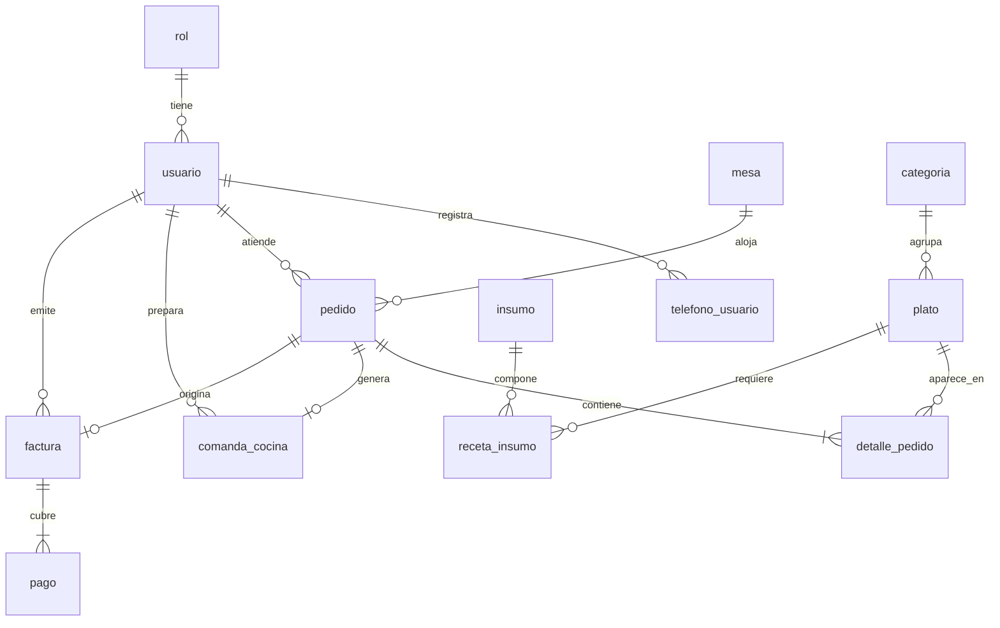

# B1 y B2 · Modelo conceptual y modelo lógico relacional

**Proyecto:** SIGRES  
**Tipo de base de datos:** Relacional (PostgreSQL), justificada por integridad referencial entre mesas, pedidos, recetas e inventario, y transacciones ACID en facturación con pagos múltiples (`RNF-19`).  
**Imagen vectorial del modelo lógico:** [diagrama_modelo_logico.svg](./diagrama_modelo_logico.svg)

---

## 1. Modelo conceptual ajustado (B1)

Reutiliza las 13 entidades conceptuales de SIGRES definidas en [G1-P2 MER](../../../../01-analysis/03-conceptual-model/04-evidence-learning/G1-P2-sigres/04_modelo_entidad_relacion.md), añadiendo el atributo multivaluado `telefono` de `USUARIO` para su transformación normalizada a tabla aparte y trazando cada entidad a su requisito funcional:

| # | Entidad | Identificador | Atributos clave | Requisito(s) que soporta |
|---|---|---|---|---|
| 1 | `ROL` | `id_rol` | `nombre`, `descripcion` | `RF01`, `RF03`, `RNF-02` |
| 2 | `USUARIO` | `id_usuario` | `nombre_usuario`, `nombre_completo`, `hash_contrasena`, `activo`, `telefonos` (multivaluado) | `RF01`, `RF02`, `RNF-06` |
| 3 | `MESA` | `id_mesa` | `numero`, `capacidad`, `estado` | `RF04`, `RF14` |
| 4 | `CATEGORIA` | `id_categoria` | `nombre`, `orden_visual` | `RF09`, `RF16` |
| 5 | `PLATO` | `id_plato` | `nombre`, `descripcion`, `precio`, `disponible` | `RF08`, `RF16` |
| 6 | `INSUMO` | `id_insumo` | `nombre`, `unidad_medida`, `stock_actual`, `stock_minimo` | `RF10`, `RF11` |
| 7 | `PEDIDO` | `id_pedido` | `fecha_hora`, `estado`, `observacion_general` | `RF04`, `RF06`, `RF17` |
| 8 | `COMANDA_COCINA` | `id_comanda` | `estado_cocina`, `hora_envio`, `hora_inicio`, `hora_listo` | `RF05`, `RF07`, `RNF-17` |
| 9 | `FACTURA` | `id_factura` | `numero_factura`, `fecha_emision`, `subtotal`, `impuesto`, `propina`, `descuento`, `total` | `RF12`, `RF15` |
| 10 | `PAGO` | `id_pago` | `metodo`, `monto`, `referencia`, `fecha_pago` | `RF13`, `RNF-19` |
| 11 | `DETALLE_PEDIDO` (asociativa) | `id_detalle_pedido` | `cantidad`, `precio_unitario`, `observaciones` | `RF04`, `RF12` |
| 12 | `RECETA_INSUMO` (asociativa) | `(id_plato, id_insumo)` | `cantidad_porcion` | `RF10`, `RF11` |

> **Nota de transición análisis (G1) → diseño (G2):** El MER conceptual de G1 incluía 13 entidades (`MOVIMIENTO_INVENTARIO` y `HISTORIAL_ESTADO_PEDIDO`). Para el esquema lógico del MVP en G2-P2 se consolidó el descuento directo sobre `insumo` vía `receta_insumo` y la trazabilidad de tiempos en `comanda_cocina` (`hora_envio`, `hora_inicio`, `hora_listo`), extrayendo además `telefono_usuario` (1FN), resultando exactamente en **13 tablas**.

* **Relaciones 1:N principales:** `ROL` *(1,1) — asigna — (0,N)* `USUARIO`; `MESA` *(1,1) — aloja — (0,N)* `PEDIDO`; `CATEGORIA` *(1,1) — agrupa — (0,N)* `PLATO`; `FACTURA` *(1,1) — recibe — (1,N)* `PAGO`.
* **Relaciones N:M principales:** `PEDIDO` *(1,N) — incluye — (0,N)* `PLATO` (resuelta con `detalle_pedido`); `PLATO` *(1,N) — consume — (0,N)* `INSUMO` (resuelta con `receta_insumo`).

---

## 2. Cuadro de reglas de transformación aplicadas (B2)

| Regla de transformación | Caso concreto en SIGRES | Resultado en el modelo lógico relacional |
|---|---|---|
| **Relación N:M $\to$ tabla intermedia** | Un `PEDIDO` incluye varios `PLATO` y un `PLATO` aparece en muchos pedidos. | Tabla `detalle_pedido(id_detalle_pedido PK, id_pedido FK, id_plato FK, cantidad, precio_unitario, observaciones)` (admite múltiples líneas del mismo plato con distintas observaciones). |
| **Relación N:M $\to$ tabla intermedia** | Un `PLATO` requiere varios `INSUMO` y un `INSUMO` se usa en varios platos. | Tabla `receta_insumo(id_plato FK, id_insumo FK, cantidad_porcion)` con PK compuesta `(id_plato, id_insumo)`. |
| **Relación 1:N $\to$ FK en lado «muchos»** | Una `MESA` aloja muchos `PEDIDO`; una `FACTURA` recibe varios `PAGO`. | `pedido.id_mesa FK`, `pedido.id_mesero FK`, `pago.id_factura FK`. |
| **Relación 1:1 $\to$ FK única (`UNIQUE`)** | Cada `PEDIDO` genera como máximo una `COMANDA_COCINA` y una `FACTURA` *(nota de diseño: en G2 se consolida 1 pedido activo por mesa con 1 factura `1:1`, resolviendo cuentas divididas mediante `factura 1:N pago`)*. | `comanda_cocina.id_pedido FK UNIQUE` y `factura.id_pedido FK UNIQUE`. |
| **Atributo multivaluado $\to$ tabla aparte** | Un `USUARIO` puede registrar uno o varios teléfonos de contacto. | Tabla `telefono_usuario(id_telefono PK, id_usuario FK, numero, tipo)`. |
| **Generalización (`Empleado`)** | `Mesero`, `Cocinero`, `Cajero` y `Administrador` comparten autenticación y difieren en permisos. | Tabla única `usuario` vinculada a `rol(id_rol FK)` (evita duplicar credenciales y simplifica autenticación `RF02`). |

---

## 3. Diagrama del modelo lógico relacional (13 tablas en 3FN)

